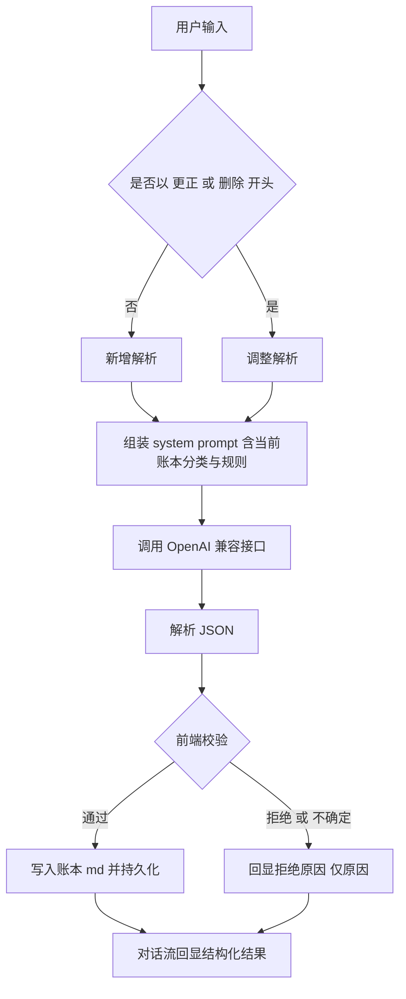

# 记账 App 详细实现方案

> 依据 [`docu/main_design.md`](../docu/main_design.md)（v0.6）编写。零构建、纯前端、数据纯本地，按模块拆分多个静态文件。

## 1. 技术选型与总体约束

| 项目 | 决策 |
| --- | --- |
| 交付形态 | 单页应用，**按模块拆分多个无构建静态文件**（`index.html` + 若干 JS/CSS 模块 + `icon.png` 等图标资源）。不追求单文件，可维护性优先 |
| 依赖 | 零外部资源：无 CDN、无框架、无图标库、无网络字体 |
| 图表 | 手写 SVG（饼图 + 折线），不引图表库 |
| 字体 | 系统字体栈 |
| 存储 | `localStorage` + 启动请求 `navigator.storage.persist()` |
| 架构 | 全局单一 `state` 对象 + 视图级重绘；事件委托绑定 |
| 版本检查 | 启动时对比服务器版本文件与本地版本常量，有更新提示，用户可忽略；支持关闭检查；增量更新由 HTTP 缓存协商实现，应用层不做增量机制 |
| 部署约束 | 静态文件不得配超长强缓存（除非文件名带内容 hash），保证重校验生效 |

## 2. 模块划分与文件结构

单一职责，按模块拆分文件（无构建，`index.html` 用 `<script>` 顺序引入）：

```text
index.html         页面骨架、静态容器、按序引入脚本与样式
css/style.css      全部样式（含 iOS 安全区适配）
js/util.js         日期、金额格式化、转义、UUID、toast
js/store.js        localStorage 读写封装、键命名、persist 请求
js/templates.js    预设模板（生活 / 项目研发）
js/ledger.js       md 解析 / 序列化 / 一致性校验 / 记录增删改
js/category.js     分类增删合并、规则拼接
js/ai.js           system prompt 构造、Chat Completions 请求、响应校验
js/chat.js         对话流、气泡渲染、纠错前缀、pending 缓冲
js/views.js        Overview / Record / Stats / Detail / Settings 渲染
js/charts.js       SVG 饼图、SVG 折线
js/io.js           导出、部分拆分、导入
js/app.js          路由、全局 state、Tab 切换、生命周期、版本检查、启动
js/version.js      版本常量 APP_VERSION（与 version.json 对比）
version.json       服务器版本文件
icon.png           图标资源
（二期）js/organize.js  AI 整理：diff、逐条裁决、部分执行、退出确认
```

> 说明：当前 [`index.html`](../index.html:1) 为单文件实现，已实现一期逻辑，将按本结构拆分对齐。

## 3. 架构与主流程



## 4. 后台数据模型

### 4.1 localStorage 键设计

```text
zh:index                 账本索引 [{id, name, template, updatedAt}]
zh:ledger:<id>           账本 md 文本（账本头 + 空行 + 记录）
zh:current               当前账本 id
zh:settings              {apiBaseUrl, apiKey, model, checkUpdate}
zh:chat:<id>             该账本对话记录数组，不参与导出
zh:pending:<id>          该账本发送失败缓冲（原文 + 时间前缀）
zh:lastExport:<id>       最近一次导出时间戳
```

- 账本互相独立文件；对话记录按账本键隔离，切换账本保存/恢复现场。
- 对话缓存不参与导入导出，清缓存/换机即丢。
- 储蓄目标存放在账本头（跟账本走），不单独建键（设置页读取/写回账本头）。
- 发送失败缓冲按账本隔离存储（`zh:pending:<id>`），避免切账本后误处理进他账本；每条缓冲项同时记录所属账本 id 作为二次校验（归属不一致则丢弃）。
- 删除账本须级联清除全部附属键：`zh:ledger:<id>`、`zh:chat:<id>`、`zh:pending:<id>`、`zh:lastExport:<id>`，同步更新 `zh:index`；若删除的是当前账本，重设或清除 `zh:current`。

### 4.2 账本 md 结构

```text
-----------------
账本：生活账本
模板：生活
支出分类：餐饮、交通、购物、居家、娱乐、医疗、教育、通讯、人情、其他
收入分类：工资、理财、其他收入
储蓄目标：3500/月
默认分类规则：
- 吃进肚子的（含买菜、食材、外卖、奶茶） - 餐饮
用户分类规则：
- 买螺丝刀 - 交通
-----------------

2026-10-01 | 支出 | 餐饮 | 35.00 | 午饭
2026-10-15 | 收入 | 工资 | 9200 | 
2026-10-17 | 支出 | 购物 | -200 | 衣服购买退款
```

解析规则：
- 账本头为第一条匹配 `/^\d{4}-\d{2}-\d{2}\s*\|/` 的记录行之前、分隔线 `---` 之内的全部内容。
- `默认分类规则：` 之下每行格式 `- 规则 - 分类`。
- `用户分类规则：` 之下每行格式 `- 规则 - 分类`。
- 导入时读文件建立账本配置，作为新账本加入。

### 4.3 记录格式

`日期 | 类型 | 分类 | 金额 | 备注`

- 日期 `YYYY-MM-DD`；类型 `支出`/`收入`；金额两位小数、退款为负、其余非负；备注不含竖线。

### 4.4 逻辑数据结构

```js
// 账本头
{ name, template, expenseCategories: [], incomeCategories: [],
  savingGoal: { amount, period: 'month' },
  defaultRules: [{ rule, category }], userRules: [{ rule, category }] }
// 记录
{ date, type: '支出'|'收入', category, amount: Number, note }
```

### 4.5 一致性校验（加载 / 导入）

- 头部声明但无记录引用：忽略。
- 记录引用了头部未声明的分类：报错并列出问题行，修正后方可使用。

## 5. 各视图实现

### 5.1 无账本态
仅显示"新建账本（选模板）/ 导入账本"两个动作，其余五视图隐藏且不可用。

### 5.2 概览（首页）
- 顶部账本名（可切换）+ 左上角账本切换/编辑，右上角设置入口。
- 本月支出 / 收入 / 结余三个数字。
- 储蓄目标进度条（读账本头 `储蓄目标`）。
- 备份提醒：距上次导出 > 10 天温和提示。

### 5.3 记账（微信对话框式）
- 聊天气泡流（用户 + AI），本地持久、按账本隔离。
- 当天记入条目内嵌对话流，可点击修改。
- 底部输入框 + 发送按钮，聚焦不被键盘遮挡。
- 回显：`已记 2 笔：餐饮 35.00（午饭）｜ 餐饮 18.00（咖啡）`。
- 纠错：以「更正」「删除」开头；未指定默认上一条，否则按日期/内容定位。
- 模糊处理：缺必要信息或分类不确定 → 只回拒绝原因。
- 容错：发送失败写入 pending（原文 + 时间前缀），每次打开询问是否处理。

### 5.4 统计
- 对比维度：日 / 月 / 年之间收支对比，可切换粒度。
- 分类占比：以月 / 年为单位的分类消费构成（SVG 饼图 + 图例 + 百分比）。
- 趋势：月份之间收入/支出趋势（SVG 折线）。

### 5.5 明细
- 全部条目按时间线排列；搜索（备注 / 分类 / 金额）；按月切换浏览；条目编辑与删除。

### 5.6 设置
- AI：API Base URL、API Key、模型名。
- 储蓄目标配置（写回账本头）。
- 版本检查开关。
- 账本管理：新建（选模板）、删除（二次确认 + 建议先导出 + 级联清除附属键，详见 4.1）、编辑分类表、用户自定义分类规则（文本框，一行一条）、导入、导出 / 拆分。

## 6. 分类体系

- 分类配置属于账本（账本头声明），AI 只能从当前账本分类表选择，禁止自创。
- 预设模板：生活 / 项目研发；最后一项固定「其他」兜底。
- 分类规则两层：默认规则 + 用户强制指令，用户指令优先。
- 变更操作：增加永远允许；合并 A→B 改写并提示记录数；删除仅在无引用时允许；改名 = 新增 + 合并。

## 7. AI 对接设计

### 7.1 请求
- OpenAI 兼容 Chat Completions；默认 DeepSeek；浏览器直连。
- 每次请求注入当前日期（设备本地时间）。

### 7.2 自动分类决策顺序（写入 prompt）
1. 先查用户强制定义（用户规则）。
2. 无则先按朴素方式直接分类。
3. 不太好分则按用途分。
4. 仍不确定则按账本头默认规则。
5. 全都不确定 → 禁止猜测，走拒绝话术要求用户指定。

示例（螺丝刀）：用户未定义 → 朴素分类失败 → 用途可分交通/居家 → 按默认规则交通仅限直接开支、居家限制较宽 → 归居家。

### 7.3 system prompt 结构
1. 角色与任务。
2. 当前日期 + 时区。
3. 当前账本支出 / 收入分类表（动态读取）。
4. 分类规则（默认 + 用户，用户优先）+ 上述决策顺序。
5. 硬规则（写死）：退款记负金额支出；资产移动记普通收支、备注写性质、内部转账不记；信用卡/花呗/白条还款不记账、刷卡消费时已记、年费/分期手续费/利息记 `支出 | 其他`；调整必须以「更正」「删除」开头。
6. 输出 JSON schema。
7. 禁止猜测分类；不确定或信息不足 → 拒绝并只给原因。

### 7.4 响应 JSON 契约

```json
{
  "action": "add | update | delete | reject",
  "records": [
    { "date": "2026-10-01", "type": "支出", "category": "餐饮",
      "amount": 35.00, "note": "午饭" }
  ],
  "target": { "date": "2026-10-01", "category": "餐饮", "amount": 35.00, "note": "午饭" },
  "reason": "未记录金额，无法记入，请补充说明"
}
```

- `add` 用 `records` 追加；`update` 用 `target` 定位 + `records[0]` 新值；`delete` 用 `target` 定位；`reject` 仅 `reason`。
- 定位策略：prompt 注入近期相关记录，LLM 返回可匹配的 `target`；前端精确匹配，多义取最近，无法定位走拒绝话术。

### 7.5 前端校验
- action 合法、金额为数字、日期格式合法。
- 分类必须存在于当前账本对应类型分类表，否则整条拒绝并转兜底话术。

## 8. 导出 / 拆分 / 导入

- 完整导出：当前账本（或时间范围子集）下载为 md，原件不动。
- 部分导出：选时间范围 → 从原账本**移出** → 生成带新账本头的独立 md 并下载；输入新账本名（默认 = 时间范围，可改）。**仅下载，不加入 App 账本列表。**
- 导入：解析文件建立账本配置并加入；与现有账本同名 → 直接拒绝。

## 9. 版本检查

- 服务器提供版本文件 `version.json`（形如 `{ "version": "1.1.0", "notes": "..." }`），应用内 `js/version.js` 定义 `APP_VERSION` 常量。
- 启动时 `fetch('version.json', { cache: 'no-store' })` 对比；有更新提示用户，用户可忽略并继续使用旧版本；设置页提供关闭检查开关。请求失败静默忽略。
- 流量不作硬约束；增量更新由 HTTP 缓存协商天然实现，应用层不做自研增量机制。
- 部署要求：静态文件不得配超长强缓存（除非文件名带内容 hash），否则版本重校验失效。

## 10. 存储防清理与 iOS 适配

- 启动调用 `navigator.storage.persist()`。
- iOS：非 standalone 模式且本地已有账本数据时，引导「添加到主屏幕」。
- 适配 iOS Safari 主屏 standalone、Android Chrome、桌面浏览器。

## 11. 二期：AI 整理

- 仅调整**分类**，**不允许修改备注**。
- 逐条列出「哪条记录、从什么改成什么」（git 式前后对照）；每条可同意 / 不同意；手动确认后执行；支持「部分处理 → 执行 → 部分处理 …」，未处理完退出需二次确认。

## 12. 实现顺序（对应 todo）

骨架与路由 → Store → Ledger → 账本管理 → 概览 → 明细 → 设置 → AIClient → 记账对话 → 统计 → 导入导出 → 版本检查/持久化/iOS → 自测。（AI 整理二期）

## 13. 已确认决策

1. 部分导出：仅下载，不加入账本列表。
2. 储蓄目标：随账本（写在账本头）。
3. 统计：日/月/年对比 + 分类占比 + 月份趋势。
4. AI 整理：不允许改备注，仅针对分类，二期实现。
5. 交付形态：按模块拆分多个无构建静态文件（不追求单文件），可维护性优先；更新问题由版本检查机制兜底。
